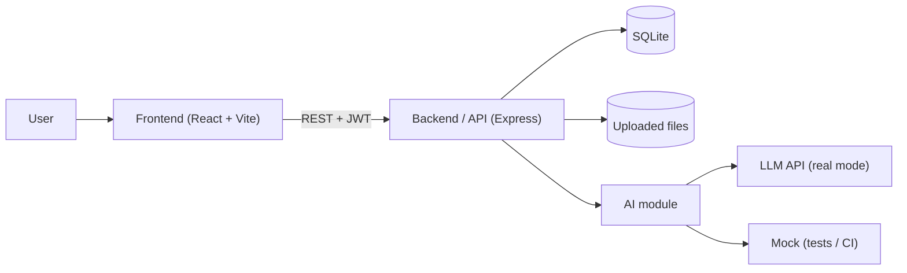
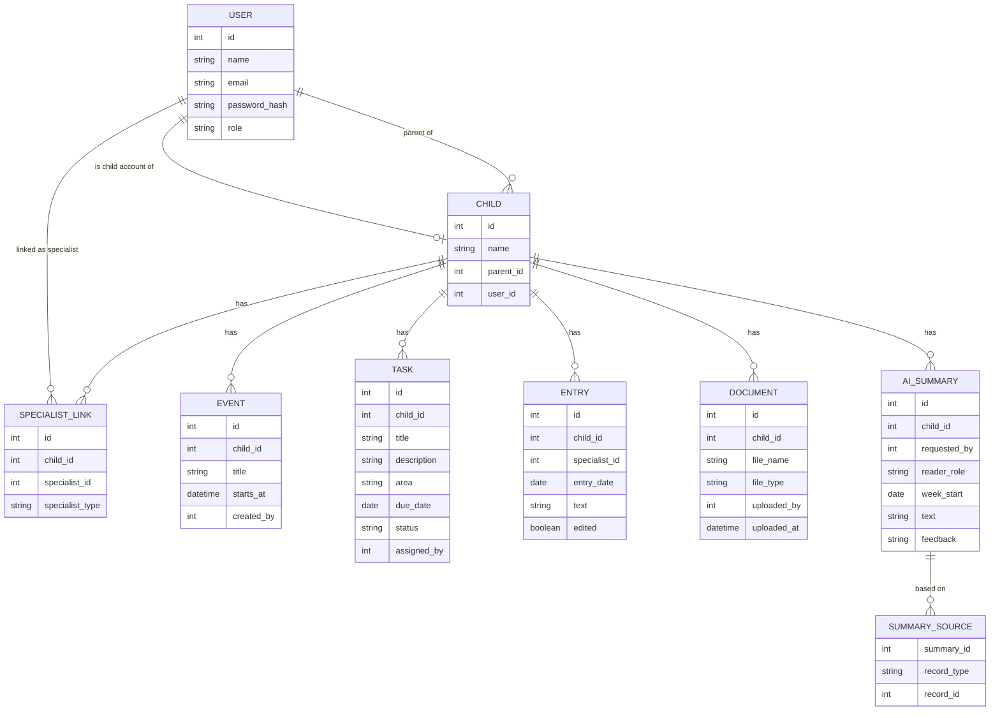
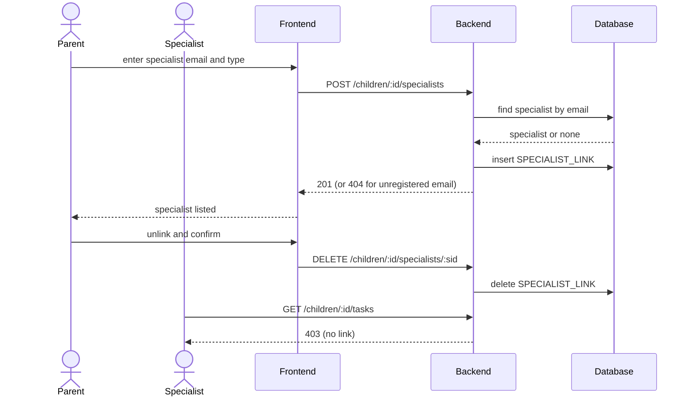
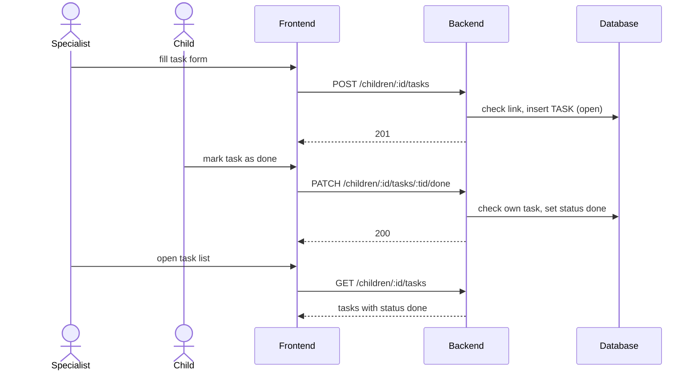
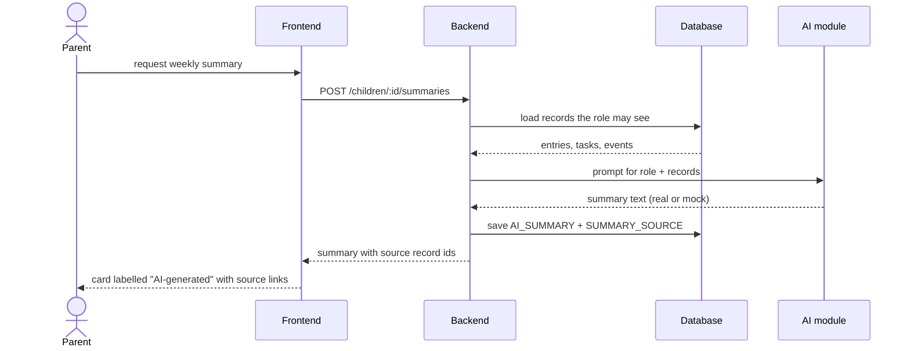

# Software Design Document (SDD)

**Team name:** TriCore  
**Version:** ☒ First version (Week 6) ☐ Final (Week 10)  
**Last updated:** 2026-10-18

---

## 1. Architecture Overview

The system is a three-tier web application: a React single-page frontend, a layered Node.js + Express REST API, and a SQLite database. The backend is split into routes, services and repositories; authentication (JWT), role checks and the child-link check run as middleware so that access rules are enforced in the API, not in the frontend. All AI calls go through one backend module that can switch between the real provider and a mock.

### Technology Stack

| Layer | Technology |
|---|---|
| Frontend | React (Vite) |
| Backend | Node.js + Express, JWT authentication |
| Database | SQLite |
| Testing | Jest + Supertest (API), Vitest (frontend), Playwright (end-to-end) |
| CI | GitHub Actions |

---

## 2. Module Design

| Module | Main components | Implements requirements |
|---|---|---|
| M1 – Login and roles | `authRoutes`, `authService`, `authMiddleware`, `requireRole`; `LoginPage`, `ProtectedRoute` | FR-M1-01 … FR-M1-05 |
| M2 – Linking specialists | `linkRoutes`, `linkService`, `requireChildAccess` middleware; `LinkedSpecialistsPage`, `ChildListPage` | FR-M2-01 … FR-M2-06 |
| M3 – Weekly schedule | `eventRoutes`, `eventService`; `WeeklyView`, `EventForm` | FR-M3-01 … FR-M3-04 |
| M4 – Tasks | `taskRoutes`, `taskService`; `TaskList`, `TaskForm`, `ChildTasksPage` | FR-M4-01 … FR-M4-05 |
| M5 – Specialist entries | `entryRoutes`, `entryService`; `EntryForm`, `EntryList` | FR-M5-01 … FR-M5-05 |
| M6 – Documents | `documentRoutes`, `documentService`, upload middleware (multer); `DocumentsPage` | FR-M6-01 … FR-M6-05 |
| M7 – Weekly statistics | `statsRoutes`, `statsService`; `StatsPanel` | FR-M7-01 … FR-M7-03 |
| M8 – Role-based AI summary | `summaryRoutes`, `summaryService`, `aiClient` (real + mock), prompt templates for parent and specialist; `AiSummaryCard` | FR-M8-01 … FR-M8-08 |

---

## 3. Data Model

---

## 4. API / Interfaces

All endpoints except login require a JWT. `:childId` endpoints return 403 for a specialist who is not linked to the child and for a child who is not that child.

| Method | Endpoint | Description | Module |
|---|---|---|---|
| POST | `/api/auth/login` | Log in with email and password, returns JWT and role | M1 |
| GET | `/api/auth/me` | Current user and role | M1 |
| GET | `/api/children` | Children visible to the current user | M2 |
| GET | `/api/children/:childId/specialists` | List linked specialists | M2 |
| POST | `/api/children/:childId/specialists` | Link a specialist by email and type (parent) | M2 |
| DELETE | `/api/children/:childId/specialists/:specialistId` | Unlink a specialist (parent) | M2 |
| GET | `/api/children/:childId/events?week=` | Events of a week | M3 |
| POST | `/api/children/:childId/events` | Add an event | M3 |
| GET | `/api/children/:childId/tasks` | List tasks (child: own tasks only) | M4 |
| POST | `/api/children/:childId/tasks` | Assign a task (parent, specialist) | M4 |
| PATCH | `/api/children/:childId/tasks/:taskId/done` | Mark a task as done (child) | M4 |
| GET | `/api/children/:childId/entries` | List entries (not for child) | M5 |
| POST | `/api/children/:childId/entries` | Add an entry (specialist) | M5 |
| PUT | `/api/children/:childId/entries/:entryId` | Edit an entry; sets "edited" | M5 |
| GET | `/api/children/:childId/documents` | List documents (not for child) | M6 |
| POST | `/api/children/:childId/documents` | Upload a PDF or image | M6 |
| GET | `/api/children/:childId/documents/:documentId/download` | Download a document | M6 |
| GET | `/api/children/:childId/stats?week=` | Completion rate in total and by area | M7 |
| POST | `/api/children/:childId/summaries` | Generate the weekly AI summary for the current role | M8 |
| POST | `/api/summaries/:summaryId/feedback` | Mark a summary as helpful or incorrect | M8 |

---

## 5. Critical Flows

### Flow 1: Parent links and unlinks a specialist

### Flow 2: Task assignment and completion

### Flow 3: Role-based AI summary

---

## 6. User Interface

| Screen | Image | Module |
|---|---|---|
| Login | `docs/img/login.png` (to be added) | M1 |
| Parent – weekly dashboard (schedule, tasks, statistics, AI summary) | `docs/img/parent-dashboard.png` (to be added) | M3, M4, M7, M8 |
| Parent – linked specialists | `docs/img/parent-specialists.png` (to be added) | M2 |
| Parent – documents | `docs/img/parent-documents.png` (to be added) | M6 |
| Specialist – child profile and new entry | `docs/img/specialist-entry.png` (to be added) | M2, M5, M8 |
| Specialist – assigning and tracking tasks | `docs/img/specialist-tasks.png` (to be added) | M4 |
| Child – my tasks | `docs/img/child-tasks.png` (to be added) | M1, M3, M4 |

---

## 7. Change Log

| Date | Change | By |
|---|---|---|
| 2026-10-18 | First version | TriCore |
