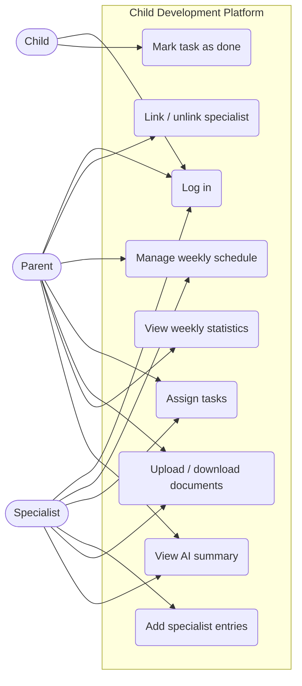

# Software Requirements Specification (SRS)

**Team name:** TriCore  
**Version:** ☒ First version (Week 6) ☐ Final (Week 10)  
**Last updated:** 2026-10-18

---

## 1. Introduction

**Purpose of the system** (2–3 sentences):

The system is a web-based decision support platform that brings parents, specialists and children together around one shared schedule, task list and record of observations. An AI component summarizes the week's records for each reader according to their role. The AI only supports decisions: every output is shown as a suggestion with its source records, and a human decides.

**Users of the system:**

| User type | Description |
|---|---|
| Parent | Owns the child's data, sees all records, and links or unlinks specialists to the child. |
| Specialist | Teacher, psychologist, doctor, special education teacher or coach. Works only with the children they are linked to. |
| Child | Sees only their own tasks and schedule and marks tasks as done. |

---

## 2. Functional Requirements

### M1 – Login and roles

| ID | Requirement | Priority |
|---|---|---|
| FR-M1-01 | The system shall let a registered user log in with email and password and receive a JWT. | Must |
| FR-M1-02 | The system shall take the user's role (parent, specialist, child) from the account; the user shall not choose it at login. | Must |
| FR-M1-03 | The system shall show each role only its own screens and hide navigation to other roles' screens. | Must |
| FR-M1-04 | The system shall show an error message and not log in the user when the email or password is wrong. | Must |
| FR-M1-05 | The API shall reject every protected request without a valid token with status 401. | Must |

### M2 – Linking specialists

| ID | Requirement | Priority |
|---|---|---|
| FR-M2-01 | The system shall let a parent link a registered specialist to the child by email and specialist type. | Must |
| FR-M2-02 | The system shall show an error when the entered email does not belong to a registered specialist. | Must |
| FR-M2-03 | The system shall list the specialists linked to the child. | Must |
| FR-M2-04 | The system shall let a parent unlink a specialist after a confirmation step. | Must |
| FR-M2-05 | The API shall answer every request about a child from an unlinked specialist with status 403. | Must |
| FR-M2-06 | The system shall show a specialist the list of children they are linked to. | Must |

### M3 – Weekly schedule

| ID | Requirement | Priority |
|---|---|---|
| FR-M3-01 | The system shall let a parent and linked specialists add an event with title, date and time. | Must |
| FR-M3-02 | The system shall list a child's events in a weekly view for a selected week. | Must |
| FR-M3-03 | The system shall show the child their own upcoming events as read-only. | Must |
| FR-M3-04 | The system shall add a monthly view of events. | Could |

### M4 – Tasks

| ID | Requirement | Priority |
|---|---|---|
| FR-M4-01 | The system shall let a parent and linked specialists assign a task with title, description, development area and due date. | Must |
| FR-M4-02 | The system shall show the child their own tasks only. | Must |
| FR-M4-03 | The system shall let the child mark one of their tasks as done. | Must |
| FR-M4-04 | The system shall show the assigner the current status (open / done) of the tasks they assigned. | Must |
| FR-M4-05 | The API shall reject task creation by the child with status 403. | Must |

### M5 – Specialist entries

| ID | Requirement | Priority |
|---|---|---|
| FR-M5-01 | The system shall let a linked specialist add a dated observation entry for the child. | Must |
| FR-M5-02 | The system shall mark an entry as "edited" after it has been changed. | Must |
| FR-M5-03 | The API shall deny the child access to all entries with status 403. | Must |
| FR-M5-04 | The system shall show all entries of the child to the parent and to every linked specialist. | Must |
| FR-M5-05 | The system shall keep a full edit history for each entry. | Could |

### M6 – Documents

| ID | Requirement | Priority |
|---|---|---|
| FR-M6-01 | The system shall let a parent and linked specialists upload a PDF or image file for the child. | Must |
| FR-M6-02 | The system shall reject files that are not PDF or image files with an error message. | Must |
| FR-M6-03 | The system shall list documents with name, type, uploader and date. | Must |
| FR-M6-04 | The system shall let the parent and linked specialists view or download a document. | Must |
| FR-M6-05 | The API shall deny the child access to all documents with status 403. | Must |

### M7 – Weekly statistics

| ID | Requirement | Priority |
|---|---|---|
| FR-M7-01 | The system shall show the task completion rate (done / assigned) for a selected week in total. | Must |
| FR-M7-02 | The system shall show the completion rate for the selected week by development area. | Must |
| FR-M7-03 | The system shall show 0 tasks and a "no tasks" message, not an error, for a week without tasks. | Should |

### M8 – Role-based AI summary

| ID | Requirement | Priority |
|---|---|---|
| FR-M8-01 | The system shall generate a summary of the selected week's records on request. | Must |
| FR-M8-02 | The system shall use separate prompts for the parent summary and the specialist summary. | Must |
| FR-M8-03 | The system shall label every summary "AI-generated" and show it as a suggestion. | Must |
| FR-M8-04 | The system shall link each summary to the source records it is based on. | Must |
| FR-M8-05 | The system shall send the AI only the records the requesting user is allowed to see. | Must |
| FR-M8-06 | The system shall instruct the AI never to make a decision or suggest a diagnosis or treatment. | Must |
| FR-M8-07 | The system shall access the AI only through a single backend module that has a mock mode for tests and CI. | Must |
| FR-M8-08 | The system shall let the reader mark a summary as "helpful" or "incorrect". | Should |

---

## 3. Non-Functional Requirements

| ID | Category | Requirement |
|---|---|---|
| NFR-01 | Security | Passwords are stored hashed (never in plain text) and no API response contains a password hash. |
| NFR-02 | Security | All access rules (role, child link) are enforced in the API; a request that skips the frontend gets the same 401/403 result. |
| NFR-03 | Privacy | The database contains only synthetic data created by the seed script. |
| NFR-04 | Performance | The weekly dashboard loads in under 2 seconds with the seed data on a local machine. |
| NFR-05 | Installability | A new developer can install and run the application locally by following the README only; the CI pipeline passes with the AI in mock mode. |

---

## 4. Critical Flows and Acceptance Criteria

| Flow | Related requirements | Acceptance criteria |
|---|---|---|
| Flow 1: Parent links and unlinks a specialist | FR-M1-01, FR-M2-01, FR-M2-02, FR-M2-04, FR-M2-05 | **Given** a logged-in parent and a registered specialist **When** the parent links the specialist by email and later unlinks them **Then** the specialist can read the child's data while linked and receives 403 on every request about the child after unlinking; an unregistered email shows an error. |
| Flow 2: Task assignment and completion | FR-M1-02, FR-M4-01, FR-M4-02, FR-M4-03, FR-M4-04, FR-M7-01 | **Given** a linked specialist and a child with no open tasks **When** the specialist assigns a task and the child marks it done **Then** the specialist sees the status "done" and the weekly completion rate includes the task. |
| Flow 3: Role-based AI summary | FR-M5-01, FR-M8-01, FR-M8-03, FR-M8-04, FR-M8-05 | **Given** a child with entries and tasks in the selected week **When** the parent requests the weekly summary **Then** the summary is labelled "AI-generated", lists its source records, and contains no record the parent is not allowed to see. |

---

## 5. Use Case Diagram

---

## 6. Change Log

| Date | Change | By |
|---|---|---|
| 2026-10-18 | First version | TriCore |
